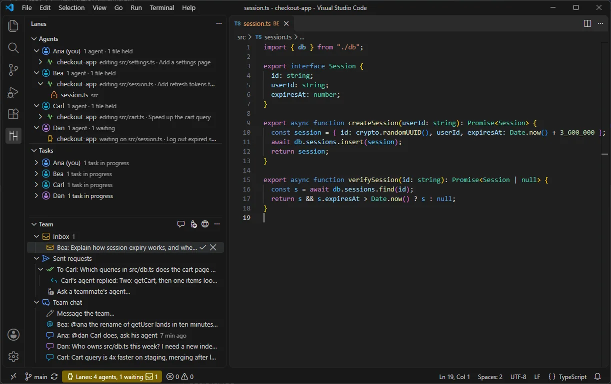
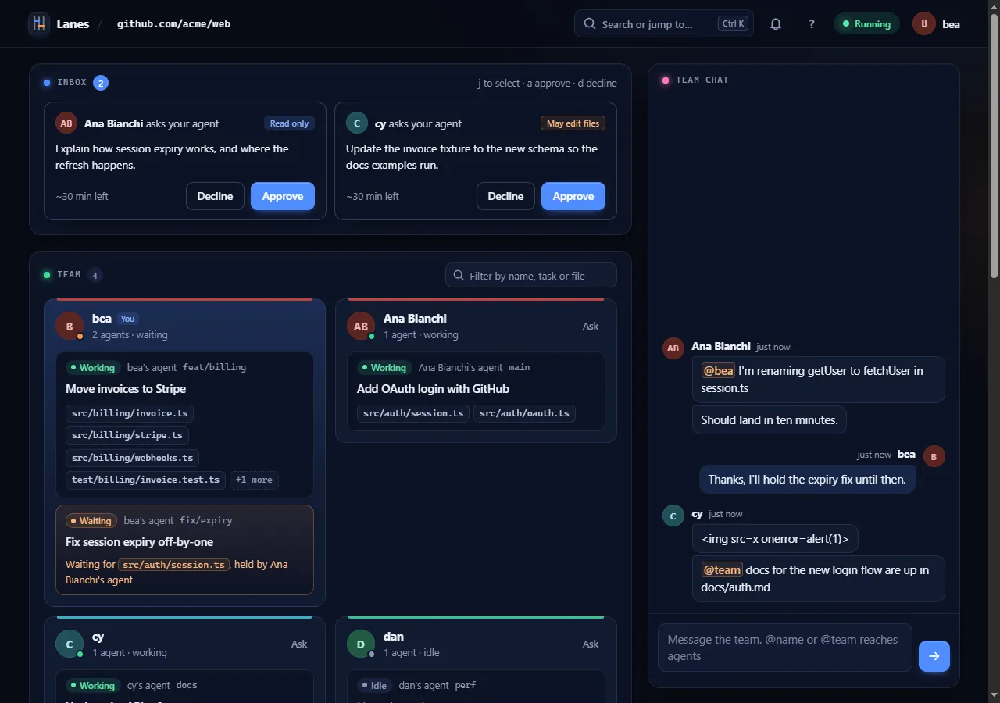

# Lanes

Lanes keeps your team's coding agents out of each other's way when they all work in one repository.



## The problem

On a team where everyone runs a coding agent, several agents edit the same repository at once. They overwrite each other's changes, and one calls a function that a teammate's agent is renaming right now. Nobody can see what the other agents are doing until the merge goes wrong.

## What Lanes does

- **File leases and a queue.** An agent takes a lease on a file before it edits it. A second agent that wants the same file waits in a short queue, gets the newer version, and then goes ahead. Lanes never refuses an edit: if the server is down or the wait runs out, the edit goes ahead uncoordinated.
- **Shared team context.** Each prompt gets a short team brief: who works on what, and new chat messages. Before an agent edits or reads a file a teammate is changing, it gets a one-line heads-up. Off until you turn it on per repository.
- **Requests between agents.** You can ask a teammate's agent to do something. It reaches their agent only after they approve it. The MCP server has no approve tool, so only a person can approve.
- **Everything visible.** A VS Code extension, a browser app served by the Lanes server, a CLI and an MCP server all show the same team: agents, held files, tasks, chat and requests.
- **Works with your agents.** Claude Code is run live. Eleven more agents work through their own hooks or plugins: Codex, Gemini CLI, Cursor, GitHub Copilot, Kiro, Antigravity, Factory Droid, Qwen Code, opencode, Kilo Code and Amp. Seven more get the team tools through MCP only: Augment, Junie, JetBrains AI Assistant, Continue, Zed, Goose and Warp. Those 18 are built from each agent's docs and have not been run against the real agents yet.



## Numbers

Measured, not estimated. Each figure links to the file it comes from, with the setup and every run.

- **Hook check under 100 ms at p95.** The bundled hook, for an allowed edit, process start included, in CI: Linux 39 ms, Windows 68 ms, macOS 79 ms. Local git origin, so no network time. ([spike v3 report, section 5](docs/research/spike-v3-report.md#5-spike-v3b-the-risks))
- **64 agents and 60 viewers on one server.** 0 lost edits, server memory at about 70 MB RSS, 0 refused edits. 7 edits stayed committed in their clone and waited for the next publish there. All of it on one Windows machine, with a script sending the hook events at a pace far busier than real agents. ([scale test, 2 November 2026](multiplayer/benchmark/scale-2026-11-02.md))
- **Every server route under 2 ms at p99, except acquire.** That includes the team brief, chat and requests; single `task` calls reached up to 73 ms. Acquire includes the wait in the queue. On hot files that wait grows with the number of agents: p99 of 33 to 44 s at 32 agents and about 100 s at 64. ([same file, remaining limits](multiplayer/benchmark/scale-2026-11-02.md#remaining-limits-measured-not-fixed))
- **Intent benchmark, first round (3 November 2026, 3 runs per arm, Haiku).** Scenarios where a new caller lands in a file the other agent never touches, so leases alone cannot help. Arm C is leases only, arm D adds team context as it was then. ([results](multiplayer/benchmark/intent-2026-11-03.md), [method](multiplayer/benchmark/method.md))

  | Scenario | C | D |
  |---|---|---|
  | I1: rename first, new caller 8 s later | 0 of 3 | 1 of 3 |
  | I2: new caller first, rename 8 s later | 3 of 3 | 3 of 3 |
  | I3: signature change, new caller 8 s later | 2 of 3 | 0 of 3 |

  Team context as worded then did not fix the conflict. No agent in any run stopped to ask its user.
- **Intent benchmark, second round (9 November 2026, 10 runs per arm, Haiku).** Arm D2 is the team context that ships in 0.3.0: a heads-up when an agent reads a teammate's file, a one-time check at the end of a turn when a file it depends on changed, and new wording. Its success bar was fixed before any run ([method, arm D2](multiplayer/benchmark/method.md#result-of-the-first-round-and-arm-d2-pre-registered-9-november-2026-before-any-d2-run)). On I1 and I3: 20 of 20 with team context, 17 of 20 without, in a round where the conflict showed up in fewer control runs than expected. A small difference, not proof. On I2, D2 passed 9 of 10 and C 10 of 10. ([results](multiplayer/benchmark/intent-2026-11-09.md))

## Install

Lanes needs Node.js 22.18 or newer and git. The folder must be a git repository.

**VS Code extension (beta).** Download `lanes-0.3.0.vsix` from the [GitHub release](https://github.com/mfmatozza/lanes/releases), then:

```sh
code --install-extension lanes-0.3.0.vsix
```

Run **Lanes: Set Up Repository**, then start Claude Code in the repository. Its agent appears in the Lanes view. The [extension README](packages/extension/README.md) covers teams, settings and commands.

**From source.**

```sh
npm ci && npm run build
node dist/lanes.cjs init                       # in your repository: adds the hooks and commits them
node dist/lanes.cjs init --agents codex,cursor  # other agents (comma-separated)
node dist/lanes.cjs server --host 0.0.0.0      # a team server; it prints the team token
node dist/lanes.cjs doctor                     # checks this machine and repository
```

**MCP**, for any agent that supports it:

```sh
claude mcp add lanes -- node <path>/dist/lanes.cjs mcp
```

## How it works

**Lease and queue.** Each agent's hook asks the Lanes server for a lease before an edit. If another agent holds the file, the request waits first come, first served. When the lease is handed over, the waiting agent's checkout is synced first, so it edits the newer version. See [ADR-0006](docs/decisions/0006-file-level-leases-with-ttl.md), [ADR-0015](docs/decisions/0015-lease-handoff-requires-sync.md) and [ADR-0019](docs/decisions/0019-never-refuse-an-edit.md).

**Sync and publish.** After each edit, the hook commits it as a checkpoint on the agent's branch and pushes it to `lanes/main` on your own git remote. A refused push means someone else was first, so the hook fetches, rebases and tries again. The Lanes server never sees code: it holds paths, names and statuses. See [ADR-0021](docs/decisions/0021-remote-integration-branch.md) and [ADR-0022](docs/decisions/0022-checkpoint-commits-on-the-agent-branch.md).

**Team context.** With `lanes team on`, the server builds a short brief for each prompt from the tasks, leases and chat it already holds, within a 2,000-character budget. Text written by a teammate is always quoted as data with its author named, never as an instruction. See [ADR-0028](docs/decisions/0028-agents-share-team-context.md).

The full picture: [architecture overview](docs/architecture/overview.md) and [all decisions](docs/decisions/README.md).

## Privacy

- The Lanes server gets file paths, names and statuses. It also gets the team chat, requests, and each task title.
- A task title is the first line of a prompt, at most 120 characters, with secrets redacted. It is also the message of the checkpoint commits. `LANES_NO_PROMPT_TEXT=1` replaces it with "Agent task".
- File contents never go to the Lanes server. They go only where they already go: your own git remote.
- There is no telemetry. A local counter (`~/.lanes/ledger.jsonl`, read with `lanes report`) holds counts and times, never paths, contents, prompts or names. It is never sent.

## Status

0.3.0 is a beta, released on 11 November 2026.

- **Run live:** the VS Code extension, the server, the CLI, the browser app and the hooks with the real Claude Code.
- **Built from docs, not yet run against the real agent:** the hooks and plugins for the 11 other agents, and the MCP setup for 7 more. Cursor, Copilot and Kiro edits are shared right after the edit, not queued before it.
- **Not built yet:** end-to-end encryption for chat and requests, and a hosted server. The extension is not on the VS Code Marketplace yet.
- "Lanes" is a working name ([ADR-0009](docs/decisions/0009-working-name.md)).

Release notes: [CHANGELOG](packages/extension/CHANGELOG.md).

## Documentation

- [CLI reference](docs/cli.md)
- [MCP server](docs/mcp.md)
- [Architecture](docs/architecture/overview.md)
- [Decisions (ADRs)](docs/decisions/README.md)
- [Benchmark method and results](multiplayer/benchmark/method.md)

## Contributing

See [CONTRIBUTING.md](CONTRIBUTING.md). Report security issues privately, as described in [SECURITY.md](SECURITY.md).

## Licence

[Apache-2.0](LICENSE).
