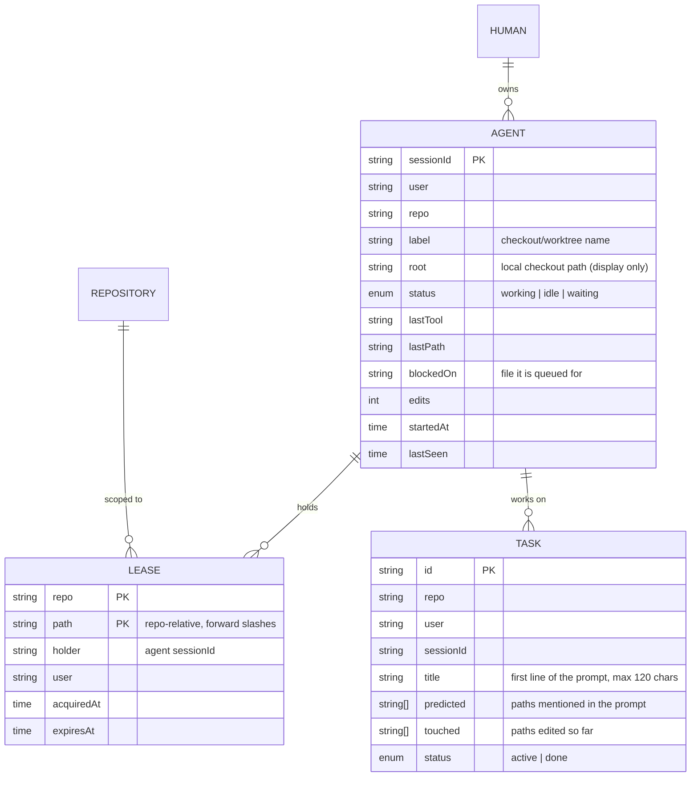
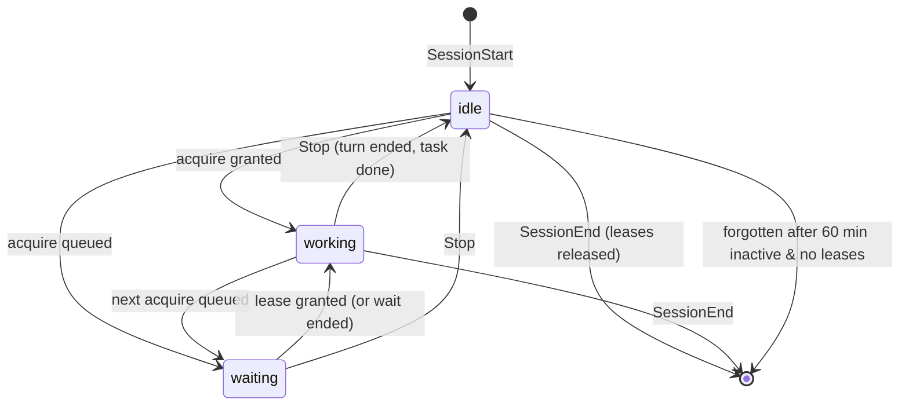

# Coordination model

> **Status:** Approved · **Owner:** @mfmatozza · **Last updated:** 2026-10-24
> [Docs](../README.md) › Architecture › Coordination model · [← Overview](overview.md) · [Protocol →](protocol.md)

This is the core of the product: the rules that decide **when** an edit goes ahead. They never decide *whether* it does: an edit is never refused ([ADR-0019](../design.md#adr-0019)).

## 1. Entities



## 2. File identity
A file is identified by the pair **(repository ID, repo-relative path)**. This holds across clones, machines and git worktrees:

| Situation | Repository ID | Path | Same lease? |
|---|---|---|---|
| Ana's main checkout `C:\code\app\src\a.ts` | `github.com/acme/app` | `src/a.ts` | — |
| Ana's worktree `C:\code\app\.claude\worktrees\x\src\a.ts` | `github.com/acme/app` | `src/a.ts` | ✅ |
| Bea's clone `/home/bea/app/src/a.ts` | `github.com/acme/app` | `src/a.ts` | ✅ |

- **Repository ID:** the `origin` remote URL, normalized (lowercase host; credentials, protocol and `.git` suffix removed; `git@host:owner/repo` becomes `host/owner/repo`). If there's no remote, it's the absolute path of the shared `.git` directory's parent. That works on one machine only, which is fine for local use.
- **Checkout root:** found by walking up from the file to the nearest `.git` entry, then confirmed with `git rev-parse --show-toplevel`.

## 3. Lease rules

| # | Rule |
|---|---|
| L1 | A lease is **exclusive**: at most one live holder per (repo, path). |
| L2 | An agent asks for a lease **before every edit** (`acquire`). No explicit "claim" step. |
| L3 | If the file is free, or held by the same agent, the lease is granted immediately. |
| L4 | If it is held by **anyone else** (including another session of the *same* human), the request **waits in a fair first-come queue** for that file, up to **240 s**. When the wait ends for any reason the edit **goes ahead**: the hook never refuses. |
| L5 | A lease lasts **one edit**. After the edit the hook **publishes** (commit, push to the integration branch) and then releases it. The next in the queue is served. |
| L6 | A lease also **expires** when `now ≥ expiresAt` (TTL, default 10 min, configurable), so a crashed agent can't block a queue. Expired leases are treated as absent immediately and swept every 5 s. |
| L7 | While the user decides on a manual **approval prompt**, the hook extends the lease (`hold`) up to **30 min**, so it can't expire under a live agent. |
| L8 | All leases held by a session are **released** when it ends (`SessionEnd`). |
| L9 | Any human can **manually release** any lease. The release is logged. |
| L10 | Humans never hold leases in the MVP. Human edits are warned about, never blocked. |
| L11 | A multi-file edit is **all or nothing**: the request is granted only when every path is free (or already held by the same agent), so two multi-file edits can't deadlock. |
| L12 | Queue limits: 4 waiters per session and 1,000 in total. Beyond that, the request returns `timeout` at once and the edit goes ahead. |

> **Why one edit and not one turn or one session?** Short leases make waits last seconds, and publishing after every edit makes deadlock impossible (spike v2: 42 sessions, 0 conflicts). See [ADR-0016](../design.md#adr-0016).

## 4. Handoff: publish and sync

```mermaid
sequenceDiagram
    participant A as Agent A hook
    participant S as Server
    participant G as lanes/main (origin)
    participant B as Agent B hook
    A->>S: acquire(file)
    S-->>A: allow
    A->>A: edit; PostToolUse
    A->>G: commit + fetch + rebase + push
    A->>S: publish(commit, paths)
    B->>S: acquire(file) [was waiting]
    S-->>B: allow + latest version of file
    B->>G: fetch
    B->>B: silent sync; agent-only note: re-read the file
```

- **Order** comes from the server; **content** comes from git ([ADR-0004](../design.md#adr-0004), [ADR-0021](../design.md#adr-0021)).
- The push is a compare-and-swap: git refuses a non-fast-forward push, and the hook fetches, rebases and retries.
- If the remote is unreachable, the edit is committed locally and pushed with the next publish. If the sync fails, the edit still goes ahead and the views flag it.
- If two edits overlap while coordination was off, the file moves to the newer content, the older version is kept in `refs/lanes/backup/...`, and only the agent is told to re-apply its change ([ADR-0019](../design.md#adr-0019)).
- Checkpoint commits stay on the **agent's branch** ([ADR-0022](../design.md#adr-0022)); only files the agent edited, or created during its turn, are committed ([ADR-0023](../design.md#adr-0023)).

## 5. Agent state machine



`waiting` replaces the v1 `blocked` state. It is shown in the views only; the agent's conversation never mentions it.

## 5a. What the agent is told
Almost nothing. All agent-facing text is **neutral and never names a teammate** (naming one made agents mention it to their user, spike v3 round 1):
- a note that a file changed and should be re-read (after a sync or an overlap re-apply);
- a note that earlier commits on its branch came from the checkpoint mechanism ([ADR-0022](../design.md#adr-0022)).

Overlaps between tasks are tracked on the server and shown in the views, **not** told to the agent ([ADR-0018](../design.md#adr-0018), amended).

## 6. Known limitations (MVP)
- **Shell writes** (`sed -i`, `cp`, code generators) aren't seen by edit hooks. The end-of-turn publish picks up files changed during the turn (not pre-existing dirty files, not secret-like, at most 1 MB), but they are not queued.
- **Semantic conflicts** across *different* files aren't detected. That needs symbol-level analysis (a later phase).
- **In-memory state:** a server restart drops all leases and the queue. Agents re-acquire on their next edit.
- **Server down:** coordination pauses and edits go ahead; a local server is restarted automatically.
