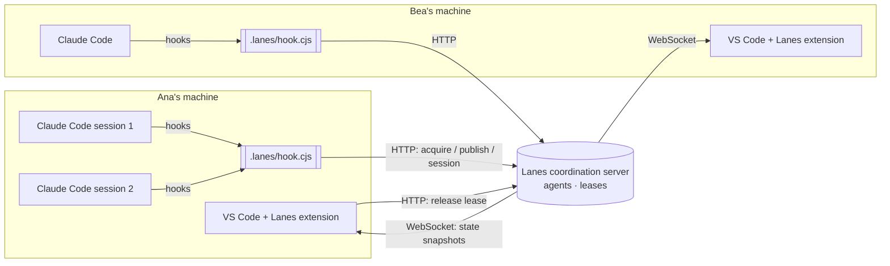

# Architecture overview

> **Status:** Approved · **Owner:** @mfmatozza · **Last updated:** 2026-10-26
> [Docs](../README.md) › Architecture › Overview · [Coordination model →](coordination-model.md)

## 1. System context



**What goes over the wire:** repository IDs, repo-relative file paths, user names, session IDs, tool names and statuses. **Never file contents.** See the [security model](security.md).

## 2. Components

| Component | Responsibility | Runs where | Spec |
|---|---|---|---|
| **Coordination server** | Source of truth for agents and leases; grants or denies edits; expires leases; broadcasts state | One per team: localhost or a teammate's machine (MVP) | [Coordination model](coordination-model.md), [Protocol](protocol.md) |
| **Hook script** (`.lanes/hook.cjs`) | Called by Claude Code at lifecycle events; turns them into protocol calls; returns allow or deny to the agent | Each developer's machine, inside every Claude Code session | [Agent integration](agent-integration.md) |
| **VS Code extension** | Visualises agents and leases; warns humans; sets up repositories; can run a local server | Each developer's VS Code | [VS Code extension](vscode-extension.md) |
| **Shared core library** | Shared types, repository identification, settings merging | Linked into all of the above | Repository structure |

## 3. Key flows

### Edit attempt (the critical path)
```mermaid
sequenceDiagram
    participant CC as Claude Code
    participant H as hook.cjs
    participant S as Server
    CC->>H: PreToolUse {session_id, tool_name: "Edit", tool_input.file_path}
    H->>H: resolve repository ID + repo-relative path (git)
    H->>S: POST /v1/acquire {user, sessionId, repo, paths, waitMs}
    alt free, or already held by this session
        S-->>H: {decision: "allow"} (lease granted/renewed)
    else held by another holder
        S-->>H: queued first come first served, then {decision: "allow"} or {decision: "timeout"}
    end
    H-->>CC: (no output → normal permission flow continues; the edit is never refused)
    Note over CC,H: server unreachable → the edit goes ahead with coordination paused (ADR-0019)
    CC->>H: PostToolUse
    H->>S: POST /v1/report (renews the lease, updates activity)
```

### State to editors
The server keeps the full state in memory and pushes a **snapshot** over WebSocket on every change (debounced by 50 ms). The state is small: dozens of agents and hundreds of leases. Snapshots keep clients simple and stateless, and that is enough for the MVP ([ADR-0011](../design.md#adr-0011)).

## 4. Architectural decisions
| ADR | Decision |
|---|---|
| 0002 | A coordination layer, not an editor |
| 0003 | VS Code extension first |
| [0004](../design.md#adr-0004) | Git is the source of truth; no CRDT for agent writes |
| [0005](../design.md#adr-0005) | Enforce through Claude Code hooks |
| [0006](../design.md#adr-0006) | File-level leases with time-to-live |
| 0007 | Fail closed by default |
| 0008 | TypeScript monorepo |
| [0010](../design.md#adr-0010) | Local-first, bring your own agent |
| [0011](../design.md#adr-0011) | Broadcast full snapshots |

## 5. Evolution beyond the MVP
- **Persistence:** SQLite or Postgres, so leases survive restarts. Needed for the hosted tier.
- **Hosted server:** multiple teams, authentication, TLS.
- **Agent adapters:** a generic ACP runner for Codex and Gemini, enforcing through ACP `fs/write_text_file` and permission requests.
- **Semantic layer:** symbol leases (tree-sitter), conflict prediction (LSP references), merge queue.
