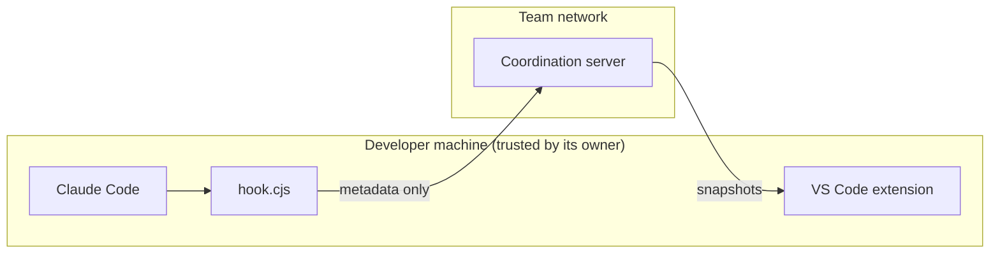

# Security model

> **Status:** Approved · **Owner:** @mfmatozza · **Last updated:** 2026-11-01
> [Docs](../README.md) › Architecture › Security · [← VS Code extension](vscode-extension.md)

## 1. Assets
| Asset | Sensitivity |
|---|---|
| Source code | High. **Never handled by Lanes** |
| File paths and repository URLs | Medium. They can reveal project structure |
| User names, agent activity | Low–medium |
| Team token, and the per-user local token (`~/.lanes/token`) | Medium. Anyone holding it can release leases and spoof agents |

## 2. Trust boundaries

- Each developer trusts their own machine and agent.
- The server is trusted by the team, but it **only ever receives metadata**.
- Other teammates (and their agents) are **semi-trusted**. They can affect your agent only through **leases and denials**, never through free-form instructions.

## 3. Threats and mitigations

| Threat | Mitigation (MVP) |
|---|---|
| Server exposed on an untrusted network | Binds to `127.0.0.1` by default. LAN mode requires an explicit `LANES_HOST` and a team `LANES_TOKEN` |
| **A web page in the developer's browser talks to the local server** (CSRF, DNS rebinding) | A bearer token on every request, even on localhost; unexpected `Host` headers refused; POSTs must be JSON. Only `/health` is open ([ADR-0023](../decisions/0023-security-baseline.md)) |
| **A web page opens the snapshot stream** (cross-site WebSocket), or a client floods it | The upgrade passes the same token and `Host` checks as any request, plus an `Origin` check (a page always sends one); at most 128 streams, client frames over 1 KB close the stream, slow readers are dropped, silent ones time out ([protocol](protocol.md#ws-v1events)) |
| **Crafted request corrupts the server** (prototype pollution, oversized input) | Maps keyed by request data have no prototype; bodies ≤ 1 MB, strings ≤ 512, ≤ 50 paths per request (≤ 5,000 per publish), ≤ 50 event streams; queue and task history bounded |
| **Secrets leave the machine** (an untracked `.env`, a token pasted in a prompt) | Lanes commits only files its agent's edit tools changed; the repo's commit and push hooks (secret scanners) still run, including on the squash commit of `lanes pr` (#211); task titles and git errors are redacted (env-var style names, `Bearer`/`--password` forms, JWTs, PEM headers, Google/Slack/npm tokens, `-p<value>`, `Authorization: Token` and `password <value>` forms included; rules are targeted so ordinary titles such as long paths, URLs, commit ids and "Bearer tokens" are left alone, see `packages/hook/src/redact.ts`; free text cannot be redacted reliably, so `LANES_NO_PROMPT_TEXT=1` keeps prompt text out of commits and the server). End-to-end scenario S1 |
| **Another local user** poisons hook caches or plants symlinks (multi-user machines) | Hook state only in `~/.lanes`, created 0700, refused if it is a symlink or someone else's |
| **Server sends values the hook passes to git** | Commit ids must be 40–64 hex characters, checked on both sides, and passed after `--end-of-options` |
| Eavesdropping on the LAN | MVP traffic is plain HTTP; only use it on trusted networks. TLS comes with the hosted tier |
| **Prompt injection between agents.** A crafted user name or path in a denial reason steers another agent | Denial reasons are built by the server from a fixed template. User names and paths are cleaned (length limit, control characters removed, backticks escaped). No free text flows between agents. *Multiplayer track ([ADR-0028](../decisions/0028-agents-share-team-context.md)), opt-in per repository:* chat and approved requests do reach other agents, always quoted as information with the author named, cleaned (control, bidi and zero-width characters stripped, length capped), and a request only after its receiver approves it |
| Spoofing: claiming leases as someone else | Accepted risk in the MVP within a trusted team token. Per-user authentication comes with the hosted tier |
| Denial of service: someone leases every file | TTL limits the damage; manual release; anomalies are logged |
| Supply chain: the hook script committed to the repo is altered | `hook.cjs` is generated by the extension; a CI check compares its hash with the released version (post-MVP) |
| Our hook accidentally approving edits | The hook **never** returns `allow` (and, since [ADR-0019](../decisions/0019-never-refuse-an-edit.md), never denies). It stays silent or adds agent-only context, so the user's own permission settings always still apply |

## 4. Data handling
- The MVP keeps everything **in memory**: no persistence, no telemetry.
- Any future telemetry is **opt-in** and covered by an ADR. The only counting today is local: a size-capped `~/.lanes/ledger.jsonl` (time, hashed repository, kind, milliseconds; no paths, contents, prompts or names) read by `lanes report`. It is never sent unless the user sends it ([agent integration](agent-integration.md#local-ledger-and-lanes-report)).
