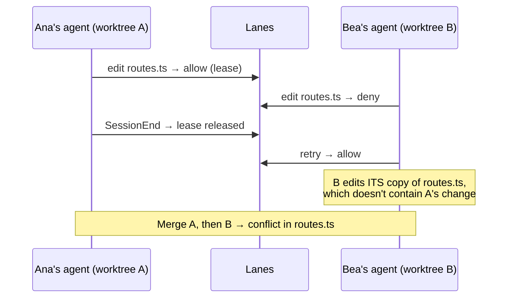

# Phase 2 spike report

> **Status:** Approved · **Owner:** @mfmatozza · **Last updated:** 2026-10-22
> [Docs](../README.md) › Research › Spike report · Plan: Phase 2 spike · Code: `spike/` · Issues #12, #13

## Recommendation: **Go, with changes**

The core mechanism works with real Claude Code agents. Agents **always** respected denials: 13 of 13, with no workaround attempts. The server adds effectively no latency. Setup committed to the repository works inside `claude --worktree` sessions.

The spike also found a **gap that changes the MVP design**. Leases stop agents editing a file *at the same time*, but when each agent works in its own worktree, **edits made one after another still conflict at merge time**. The next agent never sees the previous agent's change. The MVP must make the lease handoff include syncing. This is proposed as [ADR-0015](../decisions/0015-lease-handoff-requires-sync.md).

## Method
- **Test repository:** a 16-file TypeScript API ([`spike/testbed`](../../spike/testbed/scenarios.json)) with two hot files, `src/routes.ts` and `src/config.ts`.
- **Simulated team:** each "teammate" is a `claude -p --model haiku` session in its own git worktree. All sessions launch at the same moment. No humans were involved.
- **Volume:** 14 runs, **33 agent sessions**, scenarios S0–S7.
- **Cost:** **$0.11** API-equivalent, against a **$20** cap. It ran on the founder's existing Claude subscription.
- **Software:** Claude Code 2.1.307, Node 24.20, Windows 10.

## Results by hypothesis

| ID | Hypothesis | Result | Verdict |
|---|---|---|---|
| **H1** | Agents respect denials | **13/13 respected (100%)**. 0 shell workarounds attempted (0 Bash commands logged at all), 0 overwrites. Outcomes: 9 waited and retried until the holder finished, 4 stopped and told the user who held the file | ✅ Pass |
| **H2** | Hook latency p95 < 100 ms | Server-side check: **p95 0.47 ms**. Hook process startup (Node plus TypeScript stripping) before the request: **p95 125 ms** | ⚠️ Server passes; **hook startup fails**. Fix: ship the hook as one bundled `.cjs` file |
| **H3** | A 10-min TTL covers thinking time | 0 of 36 leases expired while their holder was alive | ✅ Pass (short tasks; re-check on long tasks while dogfooding) |
| **H4** | Same file through different worktrees → same lease | Unit tests plus S7: an agent in a `claude --worktree` checkout was denied a file held by an agent in a manual worktree | ✅ Pass |
| **H5** | Server down: the agent explains it | S4: *"Both edit attempts were blocked by a PreToolUse hook. It could not reach the Lanes coordination server at http://127.0.0.1:9…"* | ✅ Pass |
| **H6** | Committed settings work inside `claude --worktree` | S7: hooks fired in the worktree that Claude Code created; the session was coordinated | ✅ Pass |
| **S5** | A killed holder's lease expires | The holder was killed mid-task; the waiting agent was denied twice and stopped; after the TTL (45 s in this test) a new session got the lease and finished | ✅ Pass |
| **S6** | New file in new directories | `src/features/flags/index.ts` was resolved and leased correctly | ✅ Pass |
| **H7** | Without Lanes, the hot file actually conflicts | **S0 (no Lanes): 1/1 runs conflicted on `src/routes.ts`.** But **with Lanes: S1 conflicted in 2/3 runs, S2 in 5 merges across 3 runs** | ❗ See the finding below |

## Key finding: leases serialize editing, but worktrees still diverge

- **Why:** each worktree branched from the same commit. A lease ensures only one agent edits at a time, but it doesn't bring the previous holder's changes into the next holder's copy.
- **When it didn't conflict:** only in runs where the denied agent gave up instead of retrying. Those runs avoided the conflict by not doing the work at all.
- **Why it matters:** this is the exact problem behind [ADR-0014](../decisions/0014-positioning-intent-visibility.md). Coordination has to cover **integration**, not only edit timing.

**Proposed fix ([ADR-0015](../decisions/0015-lease-handoff-requires-sync.md)):** a lease handoff carries the file's *version*.
1. When a holder releases a lease, Lanes records the commit containing its last change to that file. In practice the holder's changes are committed and pushed to (or merged into) the integration branch before release.
2. The next agent asks for the lease. If its copy of the file is older than the recorded version, the hook **denies with a sync instruction**: *"Bring in the latest changes first (e.g. `git pull --rebase` / merge `main`), then retry."*
3. Lanes can do the sync automatically for clean fast-forwards.

## Other observations
- **Agents retry well.** Denied agents retried 1–3 times within their session, and most succeeded once the holder finished. The wording of the denial message works.
- **Shell use:** the agents never tried to use the shell, possibly because the prompt said "only edit files". The MVP should test without that instruction.
- **Same human, two agents (S3):** handled exactly like different humans, as rule L4 intends.
- **Cost per agent session:** about $0.003–0.005 on Haiku with tiny tasks.

## Limitations
- Haiku only, tiny tasks, small sample (33 sessions). Larger models and real tasks may behave differently, especially in how long they hold leases and in workaround attempts.
- The "teammates" were simulated with one OS user, on one machine and one server. Networks spanning several machines are untested.
- No WebSocket or VS Code UI was involved; both are MVP scope.

## Changes to carry into the MVP
| # | Change | Where |
|---|---|---|
| 1 | Lease handoff requires sync (version-aware leases) | [ADR-0015](../decisions/0015-lease-handoff-requires-sync.md) (proposed), [coordination model](../architecture/coordination-model.md) |
| 2 | Ship the hook as one bundled `.cjs` file; measure startup again (target p95 < 100 ms) | [Agent integration](../architecture/agent-integration.md) |
| 3 | Re-run H1 without the "only edit files" instruction, and with a larger model | MVP dogfooding |
| 4 | Raw results stay in `spike/results/` (git-ignored); the summary above is the record | — |
